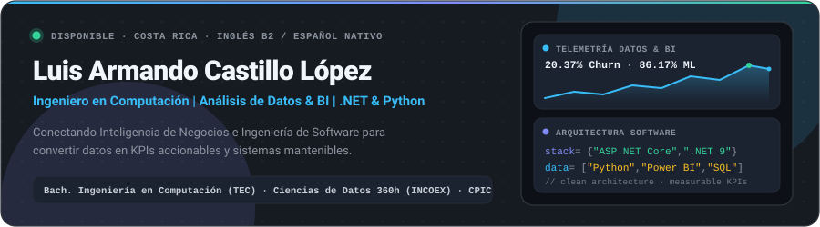
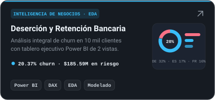
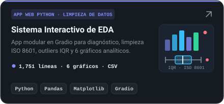
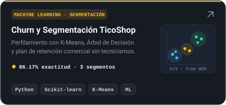
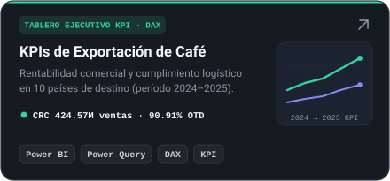
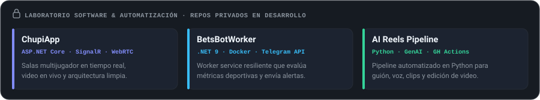
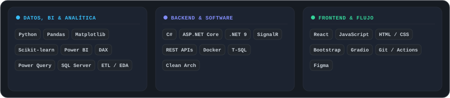

  <a href="README.md">English</a> &nbsp;·&nbsp; <strong>Español</strong>

  <picture>
    <source media="(prefers-color-scheme: dark)" srcset="assets/hero-es-dark.svg">
    <source media="(prefers-color-scheme: light)" srcset="assets/hero-es-light.svg">
    
  </picture>

### Proyectos Públicos Destacados

  <a href="https://github.com/luis-Tec/bank-churn-analytics-powerbi">
    <picture>
      <source media="(prefers-color-scheme: dark)" srcset="assets/card-nexo-es-dark.svg">
      <source media="(prefers-color-scheme: light)" srcset="assets/card-nexo-es-light.svg">
      
    </picture>
  </a>
  &nbsp;
  <a href="https://github.com/luis-Tec/sales-eda-gradio-app">
    <picture>
      <source media="(prefers-color-scheme: dark)" srcset="assets/card-eda-es-dark.svg">
      <source media="(prefers-color-scheme: light)" srcset="assets/card-eda-es-light.svg">
      
    </picture>
  </a>

  <a href="https://github.com/luis-Tec/ticoshop-churn-segmentation-ml">
    <picture>
      <source media="(prefers-color-scheme: dark)" srcset="assets/card-ticoshop-es-dark.svg">
      <source media="(prefers-color-scheme: light)" srcset="assets/card-ticoshop-es-light.svg">
      
    </picture>
  </a>
  &nbsp;
  <a href="https://github.com/luis-Tec/coffee-export-kpi-dashboard-powerbi">
    <picture>
      <source media="(prefers-color-scheme: dark)" srcset="assets/card-coffee-es-dark.svg">
      <source media="(prefers-color-scheme: light)" srcset="assets/card-coffee-es-light.svg">
      
    </picture>
  </a>

  <picture>
    <source media="(prefers-color-scheme: dark)" srcset="assets/lab-es-dark.svg">
    <source media="(prefers-color-scheme: light)" srcset="assets/lab-es-light.svg">
    
  </picture>

### Arquitectura Tecnológica

  <picture>
    <source media="(prefers-color-scheme: dark)" srcset="assets/stack-es-dark.svg">
    <source media="(prefers-color-scheme: light)" srcset="assets/stack-es-light.svg">
    
  </picture>

### Actividad de Contribuciones

  <picture>
    <source media="(prefers-color-scheme: dark)" srcset="https://raw.githubusercontent.com/luis-Tec/luis-Tec/output/github-contribution-grid-snake-dark.svg">
    <source media="(prefers-color-scheme: light)" srcset="https://raw.githubusercontent.com/luis-Tec/luis-Tec/output/github-contribution-grid-snake.svg">
    
  </picture>

  <a href="https://luis-castillo-portfolio.runasp.net/">
    <picture>
      <source media="(prefers-color-scheme: dark)" srcset="assets/btn-portfolio-es-dark.svg">
      <source media="(prefers-color-scheme: light)" srcset="assets/btn-portfolio-es-light.svg">
      
    </picture>
  </a>
  &nbsp;&nbsp;
  <a href="https://www.linkedin.com/in/luis-castillo-lopez/">
    <picture>
      <source media="(prefers-color-scheme: dark)" srcset="assets/btn-linkedin-dark.svg">
      <source media="(prefers-color-scheme: light)" srcset="assets/btn-linkedin-light.svg">
      
    </picture>
  </a>
  &nbsp;&nbsp;
  <a href="mailto:luis.castillo.lopez.dev@gmail.com">
    <picture>
      <source media="(prefers-color-scheme: dark)" srcset="assets/btn-email-es-dark.svg">
      <source media="(prefers-color-scheme: light)" srcset="assets/btn-email-es-light.svg">
      
    </picture>
  </a>

